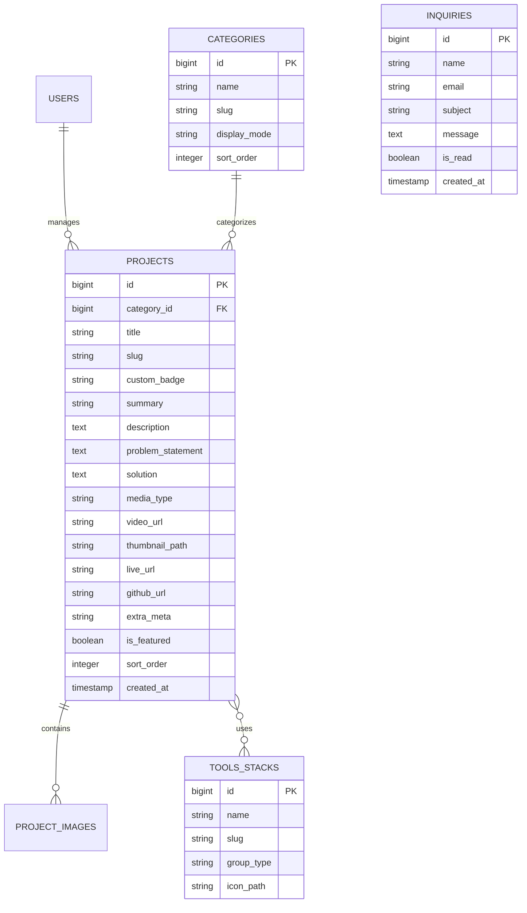

# Master Plan: Website Portofolio Taufiq Hidayat

Dokumen ini adalah panduan utama (*master plan*) dan aturan baku pembangunan website portofolio pribadi Taufiq Hidayat. Semua proses perencanaan, perancangan antarmuka, hingga eksekusi kode wajib mengacu pada dokumen ini dengan standar **Anti-Slop (Mode DURING)**.

---

## 1. Ringkasan & Spesifikasi Teknis

| Parameter | Spesifikasi |
| :--- | :--- |
| **Tujuan Website** | Menampilkan seluruh rekam jejak, hasil karya nyata, dan studi kasus dari berbagai bidang (Web Development, Video Editing, dan karya kustom lainnya) dengan sistem kategori dinamis, serta menyediakan media komunikasi dan dashboard manajemen portofolio. |
| **Kategori Portofolio** | **Dinamis & Fleksibel**: Kategori dikelola bebas via database/admin (misal: Web Development, Video Editing, Proyek Riset/Akademik, Freelance, dll.) tanpa teks statis yang kaku. |
| **Framework Utama** | **Laravel 13 + Inertia.js (React)** |
| **Bahasa & Runtime** | PHP 8.5.4, Node.js v22.12.0, TypeScript/JavaScript (React 18/19) |
| **Styling & UI** | **Tailwind CSS v4** (CSS-first `@theme`, desain orisinal terstruktur, bebas template AI slop) |
| **Web Server Lokal** | Nginx (Laragon) &mdash; Virtual Host: `http://portfolio_taufiq.test` |
| **Target Deployment** | **Vercel** (via `vercel-php` + Supabase/Neon) atau **Railway / Render** (native PHP) |
| **Database Lokal** | **PostgreSQL** (Laragon) |
| **Database Cloud** | **Supabase (PostgreSQL)** atau **Neon.tech** (Gratis, aman, dan mudah dihubungkan ke Vercel) |
| **Panel Admin** | Ya (Autentikasi aman untuk kelola kategori, proyek, upload media, dan pesan masuk) |
| **Filter Kualitas** | Anti-Slop v3.2.21 (Mode: **DURING**) |

---

## 2. Aturan Baku Desain & Anti-Slop (Mode DURING)

Sesuai aturan di [`.agents/skills/antislop/SKILL.md`](file:///e:/laragon/www/portfolio_taufiq/.agents/skills/antislop/SKILL.md), seluruh halaman dan komponen wajib mematuhi standar berikut:

### 2.1 The Craftsmanship Standard (C-1 s/d C-5)
- **C-1 (Intentionality)**: Setiap keputusan visual dan copy memiliki alasan yang jelas, bukan sekadar bawaan AI default.
- **C-2 (Functional Completeness)**: Setiap tombol, link, filter, atau form interaktif wajib berfungsi nyata atau ditiadakan.
- **C-3 (Content-Driven Composition)**: Susunan bagian halaman disesuaikan dengan konten riil portofolio, bukan meniru template landing page umum.
- **C-4 (Resilience)**: Antarmuka tahan di semua kondisi: *Empty state*, *Loading state*, *Error state*, responsif mobile tanpa patah, dan aksesibilitas keyboard.
- **C-5 (Evidence Over Claims)**: Menampilkan bukti konkret (tautan live demo, repositori kode, video player asli, tangkapan layar, penjelasan teknis masalah dan solusi) tanpa data/klaim fiktif.

### 2.2 Larangan Mutlak (Hard Gate)
1. **Dilarang Em Dash**: Tidak menggunakan karakter em dash (`—`) dalam teks antarmuka (gunakan koma, titik dua, atau kurung).
2. **Dilarang Data/Testimonial Palsu**: Tidak menampilkan review rekayasa, avatar AI, atau angka statistik palsu.
3. **Dilarang Dead Links**: Tidak ada tautan navbar atau tombol yang mengarah ke halaman kosong/tidak ada.
4. **Kontras WCAG AA**: Kontras teks terhadap latar belakang minimal 4.5:1 untuk teks biasa dan 3:1 untuk teks besar.
5. **Aksesibilitas Keyboard**: Semua elemen interaktif dapat dijangkau melalui `Tab`, diaktifkan dengan `Enter`/`Space`, dan modal ditutup dengan `Escape`.
6. **Mobile First & No Overflow**: Tidak boleh ada *horizontal scroll* pada resolusi smartphone, ukuran target sentuh tombol minimal 44px.

### 2.3 Dial Liveliness (Part 3)
Sebelum menyusun UI, tentukan 3 Dial karakter visual:
- **ENERGY: 2 (Balanced)** &mdash; Profesional, modern, bersih, namun berkarakter kuat tanpa terkesan kaku/monoton.
- **RHYTHM: 2 (Consistent with Breaks)** &mdash; Memadukan kartu interaktif web dengan showcase video dan dokumentasi studi kasus.
- **MOTION: 1 - 2 (Subtle Transitions)** &mdash; Transisi mikro halus pada hover kartu, tab perpindahan kategori, dan modal video player; tanpa animasi memantul yang berlebihan.

---

## 3. Arsitektur & Skema Data Dinamis

Seluruh kategori karya bersifat dinamis dan dapat ditambah/diubah sewaktu-waktu melalui Admin Panel tanpa mengubah kode tampilan.

### 3.1 Model Data Utama

1. **`categories` (Kategori Dinamis)**:
   - `id`, `name` (misal: "Web Development", "Video Editing", "Client Work", "Personal Lab", atau kategori akademik bebas).
   - `slug`: URL filter identifier (misal: `web-dev`, `video-editing`, dll.).
   - `display_mode`: Menentukan perilaku kartu di frontend:
     - `'web'`: Kartu fokus pada screenshot, live demo, dan repositori kode.
     - `'video'`: Kartu dilengkapi play button overlay dan pemutar video modal.
     - `'case_study'`: Kartu fokus pada penjelasan masalah, solusi, dan dokumen laporan.
   - `sort_order`: Urutan tab filter di frontend.

2. **`projects` (Data Proyek Fleksibel)**:
   - `id`, `category_id` (relasi ke tabel `categories`).
   - `title`, `slug`, `summary`, `description` (markdown/HTML).
   - `custom_badge`: Label khusus yang bisa diisi bebas (misal: "Tugas Akhir", "Freelance", "Client Project", "Open Source").
   - `media_type`: `'image'`, `'video_embed'`, atau `'video_file'`.
   - `video_url`: Tautan embed video (YouTube, Vimeo, Google Drive, direct MP4) jika bertipe video.
   - `live_url`, `github_url`: Tautan website aktif dan kode sumber.
   - `extra_meta` (JSON): Menyimpan informasi tambahan opsional secara fleksibel (misal: nama mata kuliah, tahun pengerjaan, nama klien, durasi video) tanpa perlu mengubah struktur tabel database.
   - `problem_statement`, `solution`: Pembahasan teknis studi kasus.
   - `thumbnail_path`, `is_featured`, `sort_order`, `published_at`.

3. **`tools_stacks` (Aplikasi & Teknologi)**:
   - `name`, `slug`, `icon_path`.
   - `group_type`: `'creative_software'`, `'web_stack'`, `'general_tools'`.

4. **`inquiries`** (Pesan Kontak) & **`profile_settings`** (Pengaturan Bio & Profil).

---

## 4. Struktur Antarmuka & Halaman

### 4.1 Halaman Publik (Frontend)

1. **Header & Navigasi**:
   - Identitas Taufiq Hidayat.
   - Menu navigasi cepat: Portofolio, Kumpulan Tools, Pengalaman, Kontak.
   - Status ketersediaan kerja (*Available for Projects*).

2. **Hero Section (Authentic & Direct)**:
   - Pengenalan kapabilitas multidisiplin (Teknikal Web Development & Kreativitas Video Editing).
   - Aksi langsung: "Jelajahi Karya" atau "Hubungi Saya".

3. **Dynamic Portfolio Explorer (Karya Berdasarkan Kategori)**:
   - **Filter Tab Otomatis**:
     - Mengambil seluruh kategori aktif dari database: `[Semua]` + `[Kategori 1]` + `[Kategori 2]` + dst.
   - **Tampilan Kartu Adaptif**:
     - Otomatis menyesuaikan tampilan berdasarkan `display_mode` kategori:
       - Mode Web: Menampilkan screenshot, stack teknologi, link Live Demo, dan link GitHub.
       - Mode Video: Menampilkan tombol play dan memicu **Video Player Modal** bawaan.
       - Mode Studi Kasus / Laporan: Menampilkan badge kustom, ringkasan tantangan, dan tautan dokumen/demo.

4. **Tools & Aplikasi yang Digunakan (Arsenal)**:
   - Dikelompokkan rapi ke dalam klaster (Creative Suite, Web Stack, dan General Tools) tanpa diagram persentase fiktif.

5. **Studi Kasus Unggulan (Featured Case Study)**:
   - Sorotan mendalam untuk 1–2 karya terbaik yang ditandai `is_featured`.

6. **Career & Project Milestones Timeline**:
   - Rekam jejak pengalaman, proyek penting, dan perjalanan belajar.

7. **Contact Form**:
   - Pilihan kategori keperluan, validasi ketat, status feedback interaktif via Inertia.js.

8. **Footer**:
   - Hak cipta, link media sosial, status deployment website.

### 4.2 Halaman Pengelola (Admin Dashboard)

1. **Autentikasi Aman**: Login khusus pengelola.
2. **Kelola Kategori**: Tambah, ubah nama, ganti mode tampilan (Web/Video/Studi Kasus), dan atur urutan filter.
3. **Kelola Proyek (CRUD)**:
   - Pilih kategori dinamis dari dropdown.
   - Form pintar: Menampilkan input URL Video jika kategori bertipe video, atau menampilkan input link Live Demo jika bertipe web.
   - Kolom badge kustom bebas diisi sesuai konteks proyek.
   - Upload gambar thumbnail.
4. **Master Data Tools & Aplikasi**: Menambah software/stack yang digunakan.
5. **Inbox Pesan Kontak**: Melihat dan mengelola pesan masuk.

---

## 5. Strategi Deployment ke Vercel & Arsitektur Database Cloud

### 5.1 Bagaimana Cara Deploy ke Vercel?
Vercel pada dasarnya dioptimalkan untuk arsitektur *serverless* berbasis Node.js/Next.js. Namun, website ini tetap dapat di-deploy dengan lancar dengan dua pilihan pendekatan:

1. **Jika Menggunakan Laravel + Inertia di Vercel**:
   - Menggunakan serverless runtime `vercel-php`.
   - File konfigurasi `vercel.json` disediakan di root proyek untuk memetakan request ke `public/index.php`.
   - **Penyimpanan Berkas (Uploads)**: Karena filesystem Vercel bersifat *read-only & ephemeral*, file gambar thumbnail di-upload ke layanan cloud storage gratis seperti **Cloudinary** atau **Supabase Storage** (bukan ke folder disk lokal).
   - *(Alternatif untuk Laravel: Platform seperti **Railway** atau **Render** menawarkan hosting native PHP yang langsung menjalankan Laravel persis seperti di Laragon lokal secara gratis/murah).*

2. **Jika Menggunakan Next.js di Vercel**:
   - Vercel adalah *native platform* Next.js (1-klik deploy langsung dari repositori GitHub, tanpa konfigurasi tambahan).

### 5.2 Bagaimana dengan Databasenya di Vercel?
Vercel **tidak menyediakan server database lokal di dalamnya**, melainkan menghubungkan aplikasi ke **Managed Cloud Database**. 

Arsitektur database yang kita gunakan:
- **Di Lingkungan Lokal (Laragon)**:
  - Menggunakan PostgreSQL / MySQL lokal di laptop Anda untuk proses development yang cepat dan offline.
- **Di Lingkungan Cloud / Vercel**:
  - Menggunakan layanan database cloud gratis yang sangat andal:
    - **Supabase (PostgreSQL)** *(Sangat direkomendasikan)*: Menyediakan database PostgreSQL cloud gratis hingga 500MB + dashboard manajemen data web yang intuitif + 1GB cloud storage untuk upload gambar/thumbnail.
    - **Neon.tech (PostgreSQL)**: Serverless PostgreSQL gratis dengan integrasi 1-klik di Vercel.
- **Transisi Sangat Mudah**:
  - Karena kita menggunakan ORM (Eloquent di Laravel, atau Prisma/Drizzle di Next.js), skema tabel, migration, dan query kodenya **100% sama persis**.
  - Saat ingin online di Vercel, kita cukup memasukkan kredensial database cloud (`DATABASE_URL` atau `DB_HOST`, `DB_USERNAME`, `DB_PASSWORD`) pada menu *Environment Variables* di dashboard Vercel.

---

## 6. Rencana Tahapan Eksekusi (Actionable Roadmap)

### Tahap 1: Inisialisasi Proyek & Konfigurasi Server
- [x] Buat project Laravel 13 di direktori `e:\laragon\www\portfolio_taufiq`.
- [x] Pasang Inertia.js (React) dan dependensi pendukung via Composer & npm.
- [x] Atur file `.env` untuk koneksi database lokal (PostgreSQL Laragon).
- [x] Konfigurasi Virtual Host Nginx di Laragon (`portfolio_taufiq.test` / port 8080).
- [x] Siapkan konfigurasi `vercel.json` dan `api/index.php` agar siap deploy ke Vercel kapan saja.

### Tahap 2: Database Migration, Model & Seeders (Sistem Dinamis)
- [x] Buat migration tabel `categories`, `tools_stacks`, `projects` (dengan kolom `category_id`, `custom_badge`, `video_url`, `extra_meta`), tabel pivot `project_tool`, dan `inquiries`.
- [x] Buat Model Eloquent dengan relasi lengkap dan auto-transformer embed YouTube & Google Drive.
- [x] Buat Database Seeder berisi data riil proyek dan kategori awal.
- [x] Uji migrasi dan seeder di database lokal (PostgreSQL).

### Tahap 3: Perumusan Dokumen Desain (`DESIGN.md`) & Base Styles
- [x] Tulis dokumen `DESIGN.md` yang menetapkan palet warna, tipografi, dan token CSS.
- [x] Siapkan token warna dan font (`Inter` & `Outfit`) di `app.css` dan `app.blade.php`.
- [x] Pastikan WCAG AA contrast terverifikasi pada token warna.

### Tahap 4: Pengembangan Halaman Publik (Frontend Adaptif)
- [x] Implementasikan Hero section yang berkarakter kuat.
- [x] Bangun komponen filter tab kategori dinamis (mengambil data dari tabel `categories`).
- [x] Bangun komponen kartu proyek adaptif (mode Web, mode Video dengan modal player, mode Studi Kasus).
- [x] Bangun seksi `ToolsArsenal` yang menampilkan software editing dan tech stack web secara terpisah.
- [x] Bangun komponen `ContactForm` dengan validasi Inertia dan state handling.
- [x] Sempurnakan tampilan responsif mobile (breakpoint smartphone dan tablet).

### Tahap 5: Pengembangan Admin Dashboard (Manajemen Portofolio)
- [x] Pasang sistem autentikasi sederhana & aman.
- [x] Bangun CRUD Kategori (tambah/edit nama kategori dan display mode).
- [x] Bangun form dinamis tambah/edit proyek (menyesuaikan field jika jenisnya Video / Web).
- [x] Buat fitur upload gambar thumbnail proyek (`public/storage` linked).
- [x] Bangun halaman daftar pesan masuk (*Inquiries*) dengan toggle status dibaca dan hapus.

### Tahap 6: Pengujian, Optimasi & Anti-Slop Delivery Gate
- [x] Uji fungsionalitas seluruh tombol, modal video, filter tab dinamis, dan form (R-26 & R-35).
- [x] Uji navigasi keyboard (`Tab`, `Enter`, `Escape` untuk modal) dan periksa outline fokus (R-32).
- [x] 29 PHPUnit feature & unit tests lulus 100% tanpa kegagalan.
- [x] Verifikasi browser subagent pada halaman publik dan dashboard admin.

---

## 7. Prosedur Perubahan Dokumen
Dokumen plan ini bersifat dinamis. Jika ada penambahan fitur atau integrasi baru, perbarui dokumen ini terlebih dahulu sebelum mengimplementasikannya ke dalam kode.
